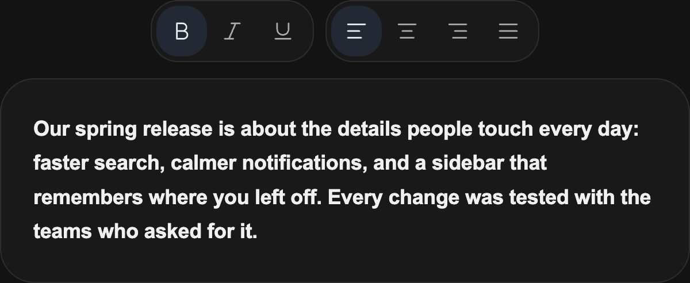

# Writing Tool Interaction

A dependency-free recreation of a minimal writing toolbar: paragraph-level **bold / italic / underline**, **four-way alignment**, and word-by-word layout animation. Built as a front-end interaction study from an 8.57-second reference clip.



## Highlights

- **Paragraph formatting** — bold, italic, and underline toggle the entire editor, matching the reference behavior. Adjacent active buttons merge into a single segmented pill.
- **Animated alignment** — left, center, right, and justify move the actual words to their new positions (FLIP animation via the Web Animations API) instead of fade-swapping static paragraphs. Rapid clicks interrupt and retarget the running animation smoothly.
- **Editable text** — a `contenteditable="plaintext-only"` paragraph with an empty-state placeholder, plain-text paste, and native text undo.
- **Draft persistence** — text and formatting are saved to `localStorage` and restored on reload; storage failures degrade silently.
- **Keyboard support** — `Tab` into the toolbar, arrow keys (plus `Home`/`End`) move between controls, and `⌘/Ctrl + B / I / U` toggle formatting.
- **Accessibility** — `aria-pressed` state on every control, a polite live region announcing changes, visible focus outlines, semantic toolbar/group roles, and full `prefers-reduced-motion` support.
- **Responsive** — 600px maximum editor width, 44px desktop controls, 18px text, and ≥44px tap targets on small screens.
- **Zero dependencies** — no build step, no network assets, no backend.

## Getting started

Open `index.html` directly in a browser, or serve it locally:

```sh
npm run dev   # http://127.0.0.1:5175
```

The dev server is just `python3 -m http.server`; there is nothing to install. Run the syntax check with:

```sh
npm run check # node --check app.js
```

## Controls

| Action | Mouse / touch | Keyboard |
| --- | --- | --- |
| Bold | Bold button | `⌘/Ctrl + B` |
| Italic | Italic button | `⌘/Ctrl + I` |
| Underline | Underline button | `⌘/Ctrl + U` |
| Alignment | Left / center / right / justify buttons | Arrow keys to focus, `Enter`/`Space` to activate |
| Edit text | Click the paragraph | Type directly |

## How it works

- [`app.js`](app.js) keeps a small `state` object (`bold`, `italic`, `underline`, `align`) and a single `render()` function that syncs `aria-pressed`, editor `data-*` attributes, and the sliding alignment indicator.
- On alignment changes, the text is split into inline-block word spans, measured **before** and **after** the layout change, then animated from the measured delta back to zero — a classic FLIP technique. Underline toggles skip the word animation because the layout does not move.
- [`styles.css`](styles.css) owns the visuals: segmented control rounding (`join-left`/`join-right`), the sliding indicator, focus and hover states, and the reduced-motion override.
- [`index.html`](index.html) is a static shell with inline SVG icons; all behavior lives in `app.js`.

## Project structure

```
index.html    static markup, toolbar, and editor
app.js        state, rendering, word-level animation, persistence
styles.css    layout, segmented controls, indicator, responsive rules
docs/         README preview image
package.json  dev server and syntax-check scripts
```

## Reference observations

Reviewed all 514 frames of the source clip using consecutive frame contact sheets, plus a full-resolution still. The clip starts with bold and left alignment enabled. Italic activates around 0.23s, underline around 1.23s, center around 2.35s, right around 3.55s, justify around 5s, underline switches off around 6.25s, and left alignment returns around 7.2s. The pointer receives a charcoal hover pill; selected controls have a muted navy background. Alignment moves the individual words rather than fading between static paragraphs. Timing and easing are approximations from rendered frames, not original source animation data.

## Notes and limitations

- Formatting applies to the whole paragraph, exactly as in the reference; there is no per-character selection formatting.
- Paste is plain text by design (`contenteditable="plaintext-only"`).
- Built for modern evergreen browsers; Safari requires a recent version for `plaintext-only` editing.
- `npm run check` validates JavaScript syntax only — there is no automated end-to-end test suite.
